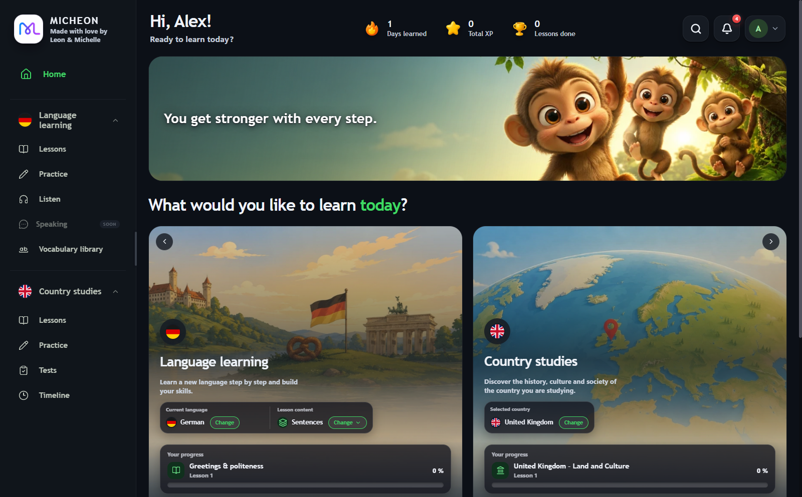
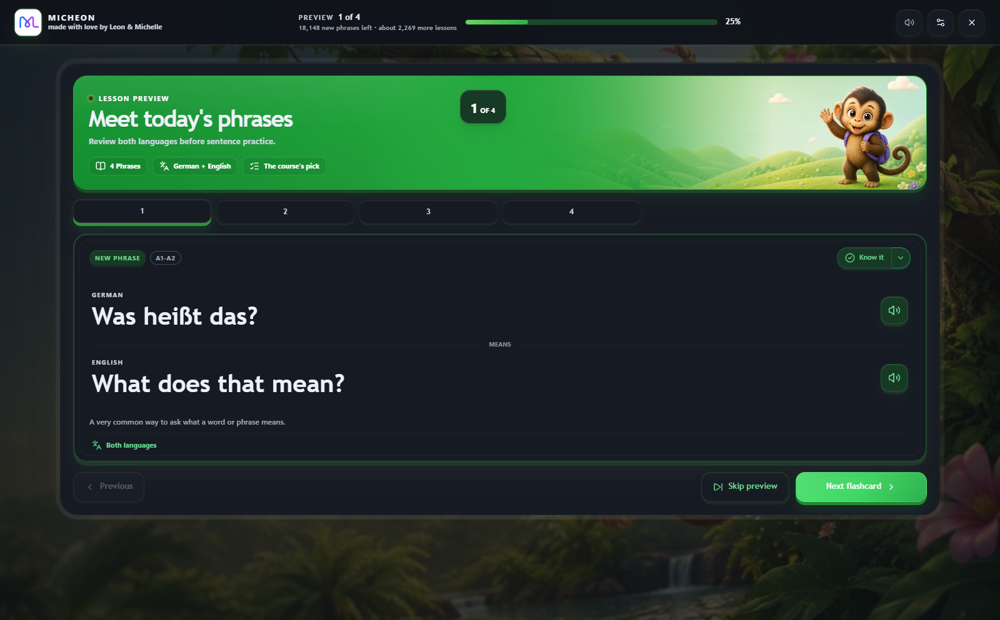
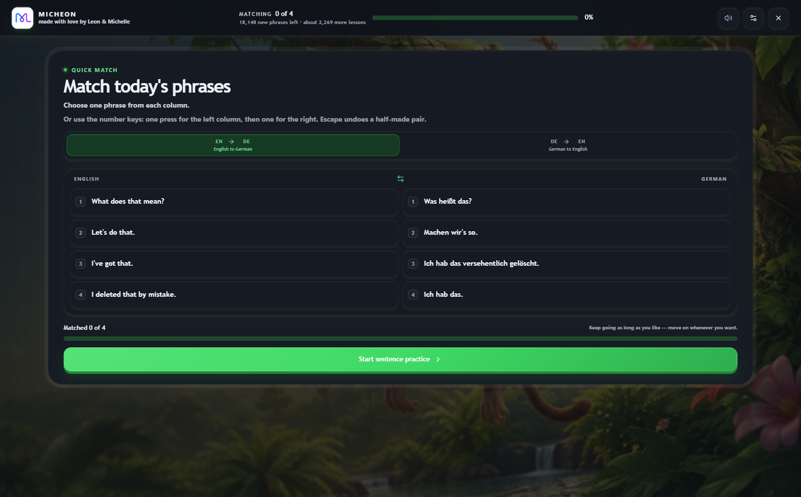
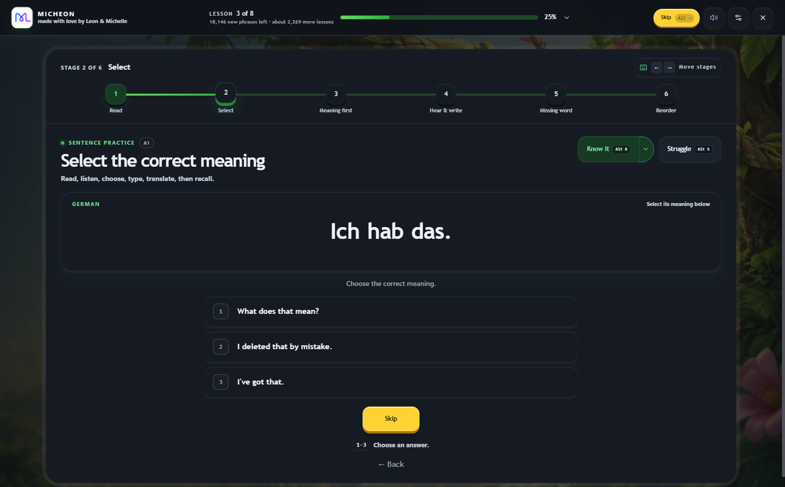
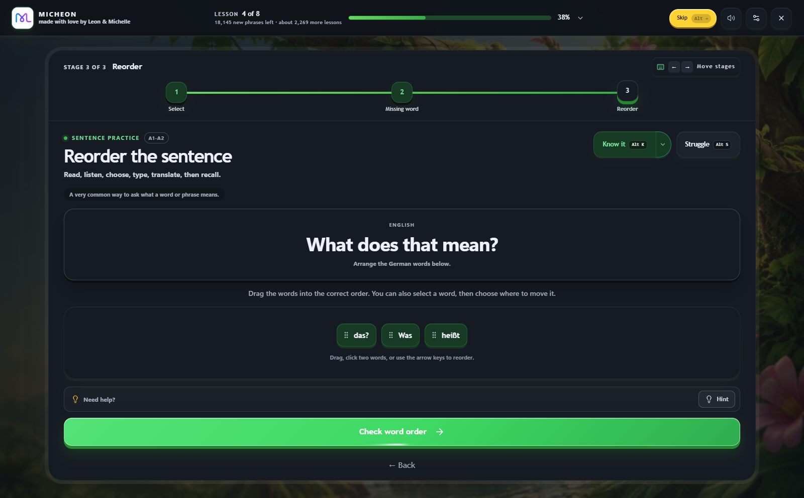
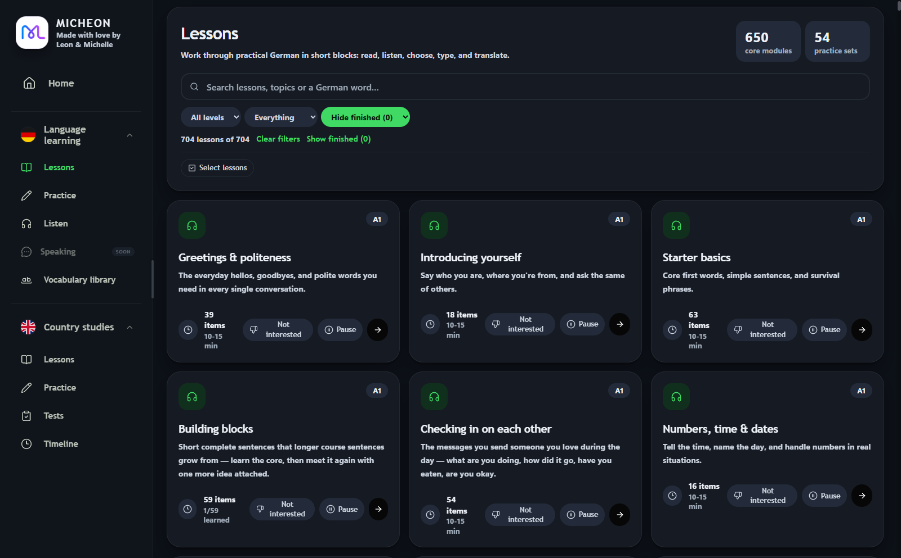
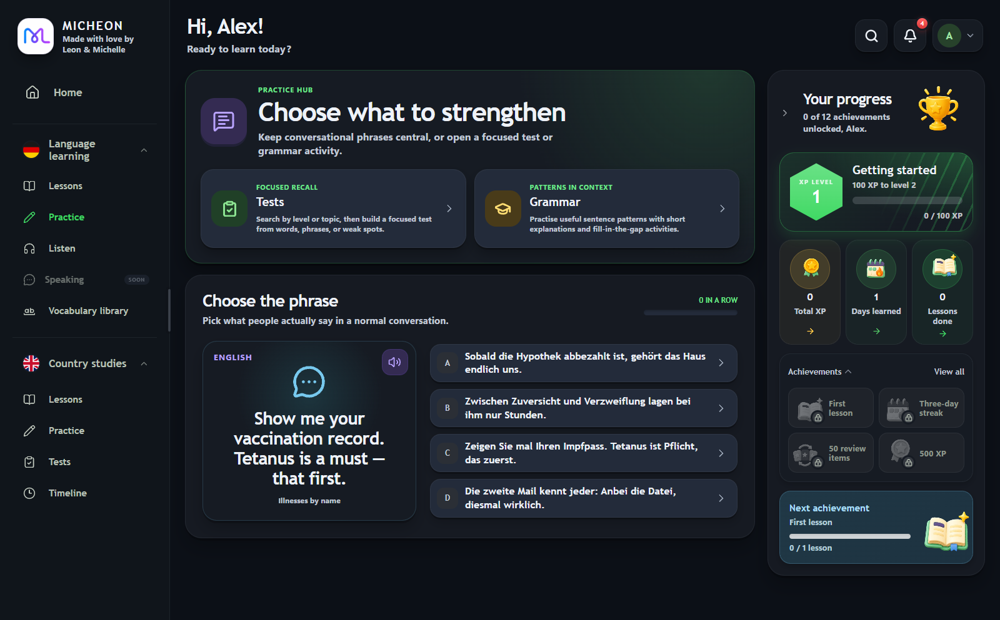
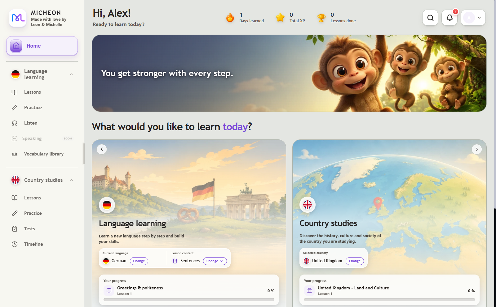

<p align="center">
  
</p>

<h1 align="center">Micheon</h1>

<p align="center">A desktop app for learning a language through real, everyday sentences: read them, hear them, choose them, type them and rebuild them from memory.</p>

<p align="center"><strong>Made with love ❤️ by Leon &amp; Michelle</strong></p>

<p align="center">
  <a href="https://github.com/Leon2k909/Micheon-Language-Learning/releases/latest"><strong>Download for Windows</strong></a>
  &nbsp;·&nbsp;
  <a href="#languages">Languages</a>
  &nbsp;·&nbsp;
  <a href="#run-from-source">Run from source</a>
</p>

<p align="center">
  
</p>

<table>
  <tr>
    <td width="50%" valign="top">
      
      <br /><strong>Lesson preview</strong><br />Meet today's phrases first, as flip cards or with both languages shown together.
    </td>
    <td width="50%" valign="top">
      
      <br /><strong>Quick match</strong><br />Pair each phrase with its meaning, by mouse or with the number keys.
    </td>
  </tr>
  <tr>
    <td width="50%" valign="top">
      
      <br /><strong>Sentence practice</strong><br />Every new sentence moves along a stage bar, from reading and hearing it to writing it and rebuilding it yourself.
    </td>
    <td width="50%" valign="top">
      
      <br /><strong>Reorder</strong><br />Put the words back in order: drag them, click two to swap, or use the arrow keys.
    </td>
  </tr>
  <tr>
    <td width="50%" valign="top">
      
      <br /><strong>Lesson library</strong><br />Hundreds of short lessons from A1 to C2, searchable and filterable by level and progress.
    </td>
    <td width="50%" valign="top">
      
      <br /><strong>Practice hub</strong><br />Focused tests, grammar in context and a quick "choose the phrase" round.
    </td>
  </tr>
</table>

<p align="center">
  
  <br /><strong>Your colours</strong><br />Dark or light, or follow Windows, with an accent colour of your choice.
</p>

---

## What it does

- **Guided lessons.** Each sitting opens with a preview of today's phrases and a quick matching round, then takes every new sentence through up to six stages: Read, Select, Meaning first, Hear & write, Missing word and Reorder. Sentences that come back for review get a shorter round.
- **Review that adapts to you.** Mark a phrase *Know it* or *Struggle*, or set its review level yourself. Shaky items come back soon; solid ones wait weeks or months, and return sooner if you slip.
- **A sensible starting point.** Start from the very beginning, or answer ten short questions and let Micheon pick a better place to begin.
- **Forgiving answer checking.** Typed answers accept contractions, everyday spoken forms and interchangeable synonyms instead of demanding one exact string.
- **Listen.** A hands-free mode that plays words, sentences and short paragraphs in both languages, in small repeating loops, while you do something else.
- **Practice and tests.** Build a test from words, phrases or your weak spots; practise grammar patterns with short explanations and fill-in-the-gap exercises.
- **Vocabulary library.** Every word and sentence you are tracking, in one place.
- **Country studies.** Courses on the history, government, culture and daily life of a country, with lessons, practice, tests and a timeline.
- **Progress you can see.** XP, levels, streaks, achievements and an estimate of the study hours left to fluent conversation.
- **Make it yours.** Dark or light theme, ten accent presets or any colour you like, a choice of lesson backgrounds (or your own picture), plus high-contrast and calmer-motion options.
- **Desk pet (optional).** An animated companion that sits on your desktop, can show what Listen is playing, and now and then asks whether you still remember a phrase.
- **Browser extension (optional).** A companion for Chrome, Edge and Brave that highlights the German words you are learning as you browse, and switches YouTube to a German dub with English captions when a video has one.

<h2 id="languages">Languages</h2>

**Language courses:** German · English (UK) · English (US) · French · Spanish · Italian · Portuguese · Polish · Russian · Greek · Albanian

- Russian and Greek can be read in their own alphabet or in Latin letters. The Russian course is still growing.
- Cards are explained in the language the app is set to. The interface is available in English, German, French, Spanish, Italian, Portuguese, Polish, Russian, Greek and Albanian.
- Many more languages are listed in the course picker as coming soon.

**Country studies:** United Kingdom · Germany · France · Spain · Italy · Poland · Russia

**Programming:** C# for s&box, a track that teaches C# (compared with Python or JavaScript, or from scratch) for building games in the s&box engine.

## Your data

- Profiles are local. There is no online account to sign up for.
- Progress is saved on your own computer, in `%APPDATA%\germ\shared-progress.json`.
- Lessons and course content ship with the app. Speech is the exception: sentences are spoken by Microsoft's online neural voices, so audio needs an internet connection.

## Download

Micheon is released for **Windows** only.

1. Open the [latest release](https://github.com/Leon2k909/Micheon-Language-Learning/releases/latest) and download `Micheon-Setup-<version>.exe`.
2. Run it. The installer is a one-click install for your user account.
3. Create a local profile and choose a course.

The installer is not code-signed, so Windows SmartScreen may ask you to confirm the first time. The installed app updates itself from GitHub releases; you can change how updates behave under **Settings → Desktop app & updates**.

<h2 id="run-from-source">Run from source</h2>

You need [Node.js](https://nodejs.org/) 22 (the version the release build uses) and npm.

```bash
git clone https://github.com/Leon2k909/Micheon-Language-Learning.git
cd Micheon-Language-Learning
npm ci

# Web version with hot reload: Vite on http://localhost:5173 plus the speech server on port 3001
npm run dev

# Desktop app: runs the full build (type check, content checks, Vite build), then opens Electron
npm run electron

# Windows installer, written to release/
npm run electron:dist
```

The full build also packs the browser extension with PowerShell, so `npm run electron` and `npm run electron:dist` expect Windows.

Built with React, TypeScript, Vite and Tailwind CSS, wrapped in Electron, with a small Express server for storage and speech.

## Licence

[GNU General Public License v3.0](LICENSE)
